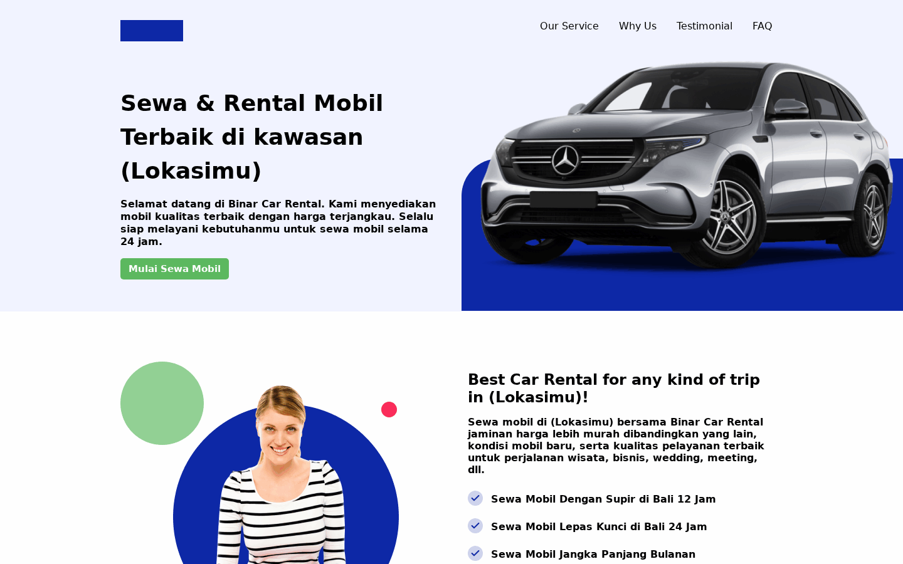
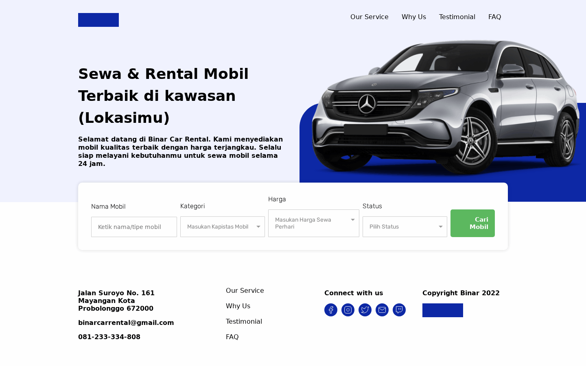

# Binar Car Rental

Binar Car Rental is a public car-rental site for people shopping for a sewa mobil.
A visitor lands on a marketing page, filters a list of rental cars, and opens a
car's details. It is front end only: there is no login, admin panel, checkout, or
saved account. Every car comes from an external rental API rather than a local
database, so the pages still render when that API is down but the car lists and
detail views cannot.



The landing page: the "Sewa & Rental Mobil Terbaik di kawasan (Lokasimu)" hero,
the "Sewa Mobil Dengan Supir di Bali 12 Jam" offer, the "Mengapa harus pilih
Binar Car Rental?" section, a Frequently Asked Question accordion, and the
footer address in Mayangan Kota Probolinggo.

## What you can do

- Browse the landing page and read what the rental covers: the services, the
  reasons to choose the company, a testimonial, and the FAQ (`/`).
- Filter rental cars by name, category, passenger capacity, daily price, and
  rental status, then submit the form to run the search (`/search`).
- See the matching cars as result cards with a photo and a price, or a
  "No Cars Found!" message when the search returns nothing (`/search`).
- Open a car's detail page for the "Tentang Paket" breakdown of what is
  included, excluded, and refundable, plus the car's own details (`/detail/:id`).



The search page shows its filter form — "Nama Mobil", "Kategori", the capacity
and price fields, "Pilih Status", and the "Cari Mobil" button — but no result
cards. Results appear only after you submit, and producing them needs the
external API.

## How it works

The app is a client-side TypeScript build. Vite type-checks the source and emits
a static `dist/` bundle that nginx serves on port 8080; there is no application
server, database, or server-side rendering in this repository. Car list and car
detail requests go directly from the browser to the external Binar Academy
rental API, and the shape of a car is described by hand-written TypeScript
types rather than a schema the server enforces.

Because the pages are client-rendered, every deep link depends on nginx's SPA
fallback: requesting `/search` or `/detail/:id` directly returns the same
`index.html`, which then loads the right screen in the browser. All UI state
lives in memory and resets when the page reloads.

## Running it

Install the exact locked dependencies and build the static output:

```sh
npm ci
npm run build
```

The build script runs `tsc && vite build` and writes the deployable site to
`dist/`. Serving that directory is an ordinary static-web-server job; the
repository's container does it with nginx on port 8080. A Vite dev server is
configured for local development, but the deployed artifact is the static
build.

## Limitations

- There is no local database, seed data, or fixture. Without a live external
  API the search form cannot return cars, and the detail page redirects to
  `/404`; the detail screen was therefore not captured in the screenshots.
- The API address is a hardcoded constant in the source, not an environment
  variable. Pointing the app at another backend means changing code and
  rebuilding.
- Testimonial and FAQ bodies are Lorem ipsum placeholders, not real copy. The
  rendered UI also shows source typos a reader will notice: "Masukan Kapistas
  Mobil" where capacity is meant, and "sabaiknya" in the FAQ.
- Whether the external API is still live, and the exact shape of its car
  responses, are `UNKNOWN — requires human input`.

Developer notes — exact locked versions, the typed data shapes, the external
service, operational risks, and how the container is assembled — are in
[TECHNICAL.md](TECHNICAL.md).
